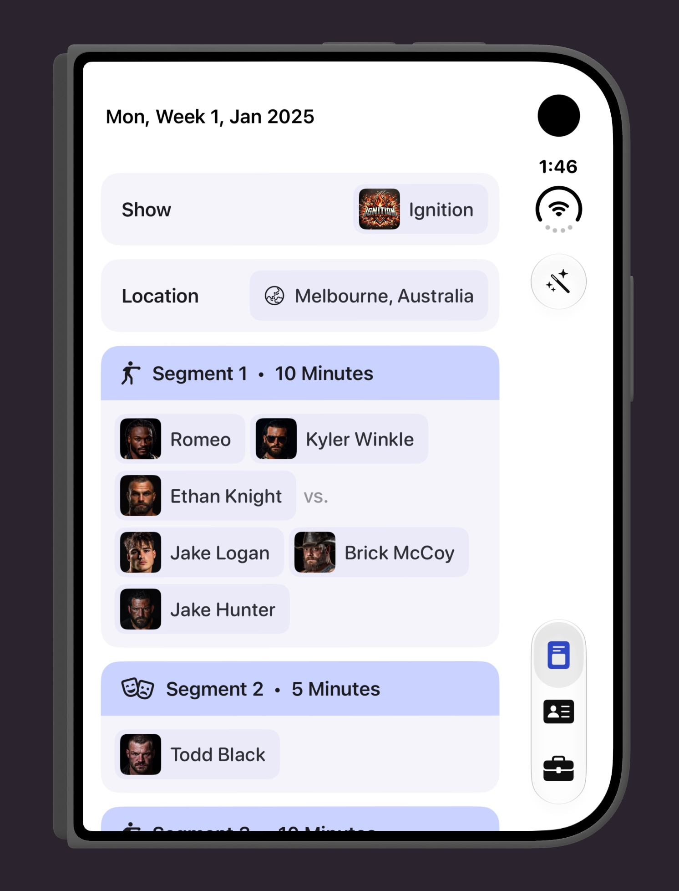
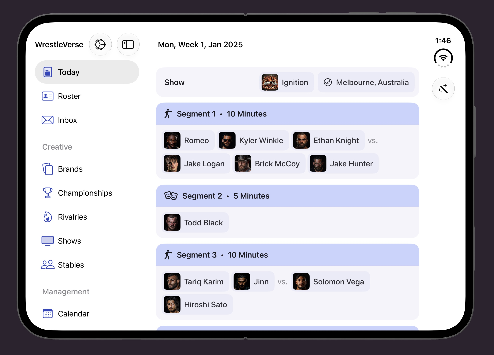

## The October Update

WrestleVerse 26.10 is now live on the App Store for iOS, iPadOS, macOS, and the Play Store for Android! This month marks the launch of Apple's new iPhone Duo, and WrestleVerse is fully ready for its launch day.

## iPhone Duo Support

WrestleVerse now adapts to the new iPhone Duo in both folded and unfolded modes.

When folded, WrestleVerse resizes to a slightly smaller version of the original iPhone app, except with toolbar buttons more conveniently located on the side of the device:

When unfolded, WrestleVerse behaves much like the iPad mini version of the app, providing a navigational sidebar, whilst retaining toolbar buttons on the side:

## Everything Else

Here's every other little detail that's new in this update:

* Added the ability to release wrestlers in Sandbox Mode
* Added landscape support on iPhone
* Improved resizable window behaviour on iPad
* Clearer & more consistent copywriting throughout the app
* Fixed a crash that would happen occasionally when booking on iOS & macOS
* Fixed a crash when adding an Angle Script on macOS